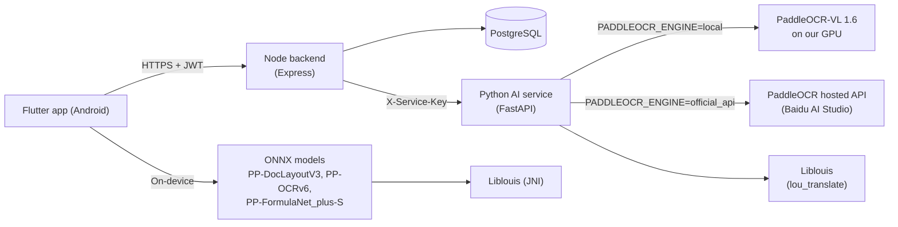

# TactileLens

TactileLens is an Android app that turns printed teaching material into
Braille for **teachers of visually impaired students**. A teacher
photographs a page (English text, algebra, tables) and gets Unified
English Braille for the text and Nemeth Braille for the math, to check,
copy and keep.

> **Status: capstone prototype.** The Braille output has **not been
> validated by a Braille expert**. Check every result before giving it to
> a student.

## Features

- **Scan a page** with the camera or from the gallery, with an optional
  crop.
- **Online or On-device** scanning. Online uses PaddleOCR-VL on a server;
  On-device runs bundled models on the phone and needs no internet.
- **Braille 2 or Braille 1** for text: contracted UEB (default) or
  uncontracted (every letter spelled out). **Nemeth** for math and table
  rows.
- **Held for review**: formulas the Braille path cannot handle safely are
  shown as text with a reason instead of possibly wrong Braille.
- **History** of scans and **Materials** (folders of saved results and
  uploaded PDF/JPG/PNG files).
- **Guest mode**: no account; scans run on the device and everything stays
  on the phone.
- Accounts with email or Google sign-in, and password reset by email.

## How it works



**Online** (signed-in users, the default): the app sends the image once
to the backend, which checks the login, size and per-user limits and
forwards it to the AI service. The AI service prepares the image,
recognises it with PaddleOCR-VL (on our own GPU, or through PaddleOCR's
hosted API), orders the blocks, parses tables, checks formulas with the
guard and translates with Liblouis. The backend saves the result to the
user's history.

**On-device** (guests always, signed-in users by choice): layout,
text-line and formula models run on the phone's CPU with ONNX Runtime;
Liblouis is compiled into the app. Nothing leaves the phone.

What differs: online reads tables into rows and applies the full formula
guard; on-device reads tables as text, holds only roots, and flags
low-confidence blocks for a check. If an online scan fails, the app
offers an on-device scan; it never switches on its own.

Details: [docs/architecture.md](docs/architecture.md).

## Safety and honesty

- **Formula blocks held for review.** Before Braille, every formula is
  checked (`ai_service/services/braille/formula_braille_guard.py`). It is
  held, with no Braille and a reason shown, when it has unsupported
  LaTeX, alignment or row markup, English words mixed into the math, a
  root, or markup left after normalisation. Unknown LaTeX would otherwise
  come out as Braille that looks right but is wrong. A false hold only
  costs the teacher a check.
- **Roots are always held** (online and on-device). The Liblouis Nemeth
  table has no radical symbol, so a root would come out as an escape
  code. They stay held until a Braille expert confirms the Nemeth
  mapping.
- **Not expert-validated.** UEB comes from Liblouis `en-ueb-g2.ctb`,
  Nemeth from `en-us-mathtext.ctb` after our own LaTeX normalisation. No
  output has been reviewed by a Braille expert yet.
- **Scan limits** (online): images up to 20 MB, one scan at a time per
  user, 30 per hour and 100 per day per user; with the hosted engine a
  daily page cap kept below Baidu's 3,000 pages (default 2,500). Hosted
  jobs are never resubmitted.
- **Privacy.** Online images go to our backend and AI service. **With the
  hosted engine they are also sent to Baidu, which stores them**, so only
  use material you may share. Guests always scan on the device; their
  scans, history and materials stay on the phone.

## Getting started

Short version (full steps, migrations and every variable:
[docs/setup.md](docs/setup.md)):

```
git submodule update --init --recursive

# 1. Backend (needs PostgreSQL and backend/.env)
cd backend && npm install && npm run dev

# 2. AI service (variables come from the shell, not a file)
cd ai_service && pip install -r requirements.txt
#    local engine: also paddlepaddle-gpu 3.2.1 (CUDA 12.6) and paddleocr[doc-parser] 3.7.0
#    hosted engine: set PADDLEOCR_ENGINE=official_api and PADDLEOCR_ACCESS_TOKEN
python -m uvicorn app:app --host 127.0.0.1 --port 8000

# 3. App on a USB phone
adb reverse tcp:5000 tcp:5000
cd frontend && flutter run --dart-define=AI_BASE_URL=http://127.0.0.1:5000 --dart-define=BACKEND_BASE_URL=http://127.0.0.1:5000
```

On-device scanning needs the ONNX models (about 390 MB, not in git) in
`frontend/android/app/src/main/assets/paddle_onnx/`; see the setup guide.

Main variables (names only; never commit values):

| Where | Name | What it does | Default |
|---|---|---|---|
| backend | `DB_HOST`, `DB_PORT`, `DB_NAME`, `DB_USER`, `DB_PASSWORD` | PostgreSQL | none |
| backend | `JWT_SECRET` | signs login tokens | none, required |
| backend | `AI_SERVICE_URL` | AI service address | none, required for online scans |
| backend + AI service | `AI_SERVICE_SECRET` | shared `X-Service-Key` | none (local development only) |
| backend | `SCAN_LIMIT_PER_HOUR`, `SCAN_LIMIT_PER_DAY` | online scan limits | `30`, `100` |
| AI service | `PADDLEOCR_ENGINE` | `local` or `official_api` | `local` |
| AI service | `PADDLEOCR_ACCESS_TOKEN` | hosted API token | none |
| AI service | `PADDLEOCR_DAILY_PAGE_CAP` | hosted pages per day (below 3000) | `2500` |
| AI service | `LIBLOUIS_ROOT` | Liblouis folder | `ai_service/vendor/liblouis` |
| app | `AI_BASE_URL`, `BACKEND_BASE_URL` | backend address | `http://10.0.2.2:5000` |
| app | `AI_SCAN_MODE` | `session`, `offline`, `remote`, `hybrid` | `session` |
| app | `GOOGLE_SERVER_CLIENT_ID` | Google sign-in | none |

The full tables (email, password reset, timeouts, hosted API settings)
are in [docs/setup.md](docs/setup.md#environment-variables).

## Testing

| Part | Command | Result |
|---|---|---|
| AI service (Python) | `cd ai_service && python -m unittest discover -s services -t . -p "test_*.py"` | 147 passed, 1 skipped |
| Backend (Node) | `cd backend && npm test` | 31 passed |
| App (Flutter) | `cd frontend && flutter test` | 241 passed |
| Android (Kotlin) | `cd frontend/android && ./gradlew :app:testDebugUnitTest` | 4 passed |
| VL tools | `cd tools/training_vl && python -m unittest discover -s tests -t .` | 15 passed |

Measured on 2026-10-26 at commit `73265e9` (Windows 11; Python 3.11.9
with PaddleOCR 3.7.0, Node 22.18, Flutter 3.44.7). The skipped Python
test only runs where PaddleOCR is not installed. No test sends anything
to the hosted API.

## Project structure

```
TactileLens/
├── ai_service/                  Python AI service (FastAPI)
│   ├── app.py                   endpoints: /health, /api/scan-document
│   ├── modal_app.py             deployment on Modal (NVIDIA L4)
│   └── services/
│       ├── ocr/                 scan pipeline, hosted API client, block order, normalisers, tables
│       ├── braille/             Liblouis translation, LaTeX-to-Nemeth input, formula guard
│       └── security/            X-Service-Key check
├── backend/                     Node backend (Express, PostgreSQL)
│   ├── src/                     routes, controllers, scan proxy and limits, migrations
│   └── test/                    node:test tests
├── frontend/                    Flutter app
│   ├── lib/                     screens, services, models, widgets
│   ├── android/                 Kotlin on-device pipeline, JNI bridges, ONNX assets (not in git)
│   ├── test/                    Flutter tests
│   └── third_party/             Liblouis and llama.cpp (git submodules)
├── docs/                        architecture, setup, evaluation plan
└── tools/
    ├── model_prep/              inspect and test the ONNX exports
    ├── training/                offline recognizer: synthetic data, worksheets, evaluation, trial training
    └── training_vl/             PaddleOCR-VL: SFT data converter, evaluation harness
```

## Evaluation and training status

All models in the app are **pretrained**; none has been replaced by one
we trained.

- **Offline recognizer baseline** (PP-OCRv6 small rec, on a 200-line
  **synthetic** set of algebra lines with raised characters): 68.5%
  exact lines, 59.7% exact on lines with superscripts, 11.1% on negative
  exponents.
- **First fine-tuning trial** of that recognizer, on synthetic lines
  from the same generator: 99.0% exact and 98.7% on lines with
  superscripts on the same synthetic set. **Synthetic only**: not tested
  on real photos (none collected yet) and likely optimistic because train
  and test come from the same generator. Not in the app. Tools:
  [tools/training/](tools/training/README.md).
- **Online model evaluation harness** ([tools/training_vl/](tools/training_vl/README.md)):
  converts labelled images to ERNIEKit fine-tuning data with a guard
  that keeps evaluation images out of training, and compares engines
  (local PaddleOCR-VL, hosted API, a future fine-tuned model) on a
  held-out set. It has only been run on generated test images; there
  are no accuracy results on real material yet.
- **The hosted API cannot be fine-tuned.** Only our own copy of the
  open PaddleOCR-VL can, with ERNIEKit; its documented setup is an
  80 GB GPU, and a fine-tuned model would need our own GPU hosting.
  This is future work.
- The evaluation dataset is planned, not finished:
  [docs/evaluation/DATASET_PLAN.md](docs/evaluation/DATASET_PLAN.md),
  [dataset card](docs/evaluation/dataset_card.md),
  [results template](docs/evaluation/RESULTS.md).

## Known limitations and roadmap

- Roots are held (no Braille) until the Nemeth radical is confirmed by
  the Braille expert.
- Nemeth spacing and baseline questions, and the UEB handling of some
  symbols, are waiting for the Braille expert.
- Tables use Nemeth for every row, and on-device scans read tables as
  plain text.
- A scan cannot be cancelled once started (Back is disabled while it
  runs).
- Online scan limits are kept in memory and reset when the backend
  restarts.
- The app's Privacy screen does not yet mention that the hosted engine
  sends images to Baidu.
- No migration creates the `users` and `materials` tables; no
  `backend/.env` template is committed.
- On-device scanning and Braille 1 are Android only; iOS is untested.
- The evaluation dataset of real worksheets is still being completed;
  then: baseline on real photos, a decision on the recognizer, and
  expert review of the Braille.

## Credits and licenses

| Component | Used for | License |
|---|---|---|
| [PaddleOCR](https://github.com/PaddlePaddle/PaddleOCR) 3.7 / PaddleX, PaddleOCR-VL models | online recognition | Apache-2.0 |
| [PaddlePaddle](https://github.com/PaddlePaddle/Paddle) 3.2 | runs PaddleOCR-VL | Apache-2.0 |
| PP-DocLayoutV3, PP-OCRv6, PP-FormulaNet_plus-S (PaddleOCR models, ONNX) | on-device recognition | Apache-2.0, as PaddleOCR (where the ONNX exports were obtained is not recorded in the repo) |
| [ONNX Runtime](https://github.com/microsoft/onnxruntime) Android 1.21.1 | on-device inference | MIT |
| [Liblouis](https://github.com/liblouis/liblouis) 3.38.0 | Braille translation | library LGPL-2.1-or-later; command-line tools (`lou_translate`, used by the AI service) GPL-3.0-or-later |
| [llama.cpp](https://github.com/ggml-org/llama.cpp) | on-device VL experiment (not used by the app) | MIT |

Open fonts, used **only** by `tools/training` to draw synthetic training
and test images (the app bundles no fonts): DejaVu (Bitstream Vera
license + public domain), STIX and Liberation (SIL Open Font License
1.1), TeX Gyre and Latin Modern (GUST Font License). The fonts and their
license files live in the training data folder, outside git.

The PaddleOCR hosted API is a Baidu AI Studio service under its own
terms.

## For reviewers

**Try it in 5 minutes** (an Android build with the ONNX models; steps 1–4
need no server):
1. Open the app and choose **Continue without an account** (guest mode):
   everything runs on the phone.
2. Scan a printed page with a short paragraph and an equation such as
   `x² + 3x − 5 = 0`.
3. On the result, switch **Braille 1 / Braille 2** for the text; the math
   stays Nemeth.
4. Scan `√(x + 9) = 5`: it is **held for review** with the reason, not
   translated.
5. With the backend and AI service running, sign in, choose **Online**,
   scan again, then open **History** and **Materials**.

**Where to look:** tests in the table above (Python tests sit next to the
code in `ai_service/services/`); the formula guard in
`ai_service/services/braille/formula_braille_guard.py`; evaluation tools
and their result format in `tools/training/` and `tools/training_vl/`;
the dataset plan in `docs/evaluation/`.
